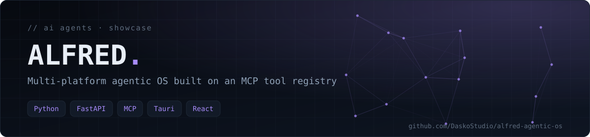
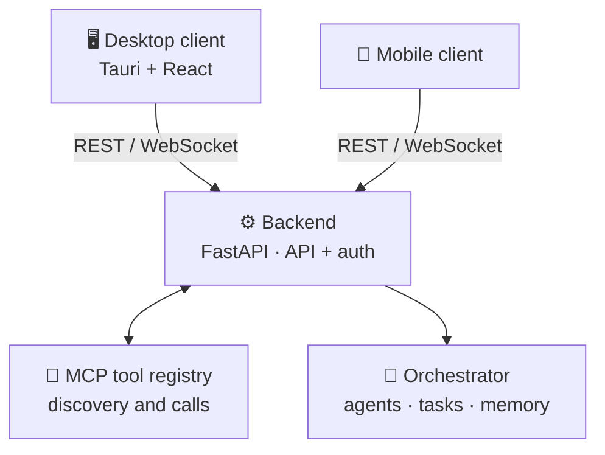

<div align="center">



**An autonomous, multi-platform assistant that orchestrates tasks through a registry of MCP (Model Context Protocol) tools, with desktop and mobile clients connected to a backend.**

     

[Concept](#-concept) · [Architecture](#-architecture) · [Getting started](#-getting-started) · [Tech stack](#-tech-stack)

</div>

> [!IMPORTANT]
> **Showcase repository.** This is a *sanitised public copy* of a personal project. It presents the architecture and the technical choices **without sensitive code, secrets or private modules**. The application core stays private: every API route below the health check is a stub that answers `501 Not Implemented`.

## 📖 Concept

ALFRED is an *agentic OS*: instead of a single chat window, it is a set of agents that can discover tools, call them, and coordinate work across devices. Tools are exposed through a standard **MCP registry**, so an agent can find and invoke capabilities without hard-coded integrations. A desktop client and a mobile client both talk to the same backend.

## 🏗️ Architecture



## 📦 What this repository contains

| Component | Status in this repository |
|---|---|
| `GET /health` | ✅ Returns `{"status":"ok"}` |
| `GET /api/tools` | ⛔ Stub — HTTP 501 |
| `POST /api/tools/{name}/call` | ⛔ Stub — HTTP 501 |
| `POST /api/agents/run` | ⛔ Stub — HTTP 501 |
| `ToolRegistry` contract (`register`, `list_tools`, `call`) | ⛔ Interface only |
| `Agent` abstract class (`run`) | ⛔ Interface only |
| Desktop and mobile clients | Package manifests only — no runnable client |

The concepts described on this page are the *target* private architecture. No MCP server, real tool, orchestration logic, WebSocket handler or working client is implemented here.

## 🧭 Key design ideas

- **MCP registry** — standardised discovery and invocation of tools by agents.
- **Multi-agent orchestration** — a task is decomposed and dispatched to specialised agents.
- **Multi-platform** — a local desktop client plus a mobile client that relies on the remote backend.
- **Security by placement** — secrets and execution stay server side; clients only expose the UI.

## 🚀 Getting started

**Prerequisites:** Python 3.11+.

```bash
python3 -m venv .venv
source .venv/bin/activate
pip install -r requirements.txt
uvicorn app.main:app --reload --host 127.0.0.1
```

```bash
curl http://127.0.0.1:8000/health          # {"status":"ok"}
curl -i http://127.0.0.1:8000/api/tools    # HTTP 501 not implemented
```

Interactive API docs: <http://127.0.0.1:8000/docs>. No secret or external service is required.

## 🗂️ Project structure

```text
app/
  main.py           FastAPI application and health check
  api/routes.py     Route stubs (501)
  core/registry.py  ToolRegistry contract
  agents/base.py    Abstract Agent
  skills/           Reserved: native tools / skills
bridge/             Reserved: bridge between clients and backend
desktop/            Tauri + React manifest
mobile/             Mobile client manifest
scripts/ docs/ tests/   Reserved placeholders
```

## 🧰 Tech stack

Python · FastAPI · Uvicorn · MCP · Tauri (Rust) · React · WebSocket (target)

---

<div align="center">

<sub>Built by <a href="https://github.com/DaskoStudio"><b>Konaté Adama</b></a> · <a href="https://github.com/DaskoStudio?tab=repositories">More projects</a></sub>

</div>
